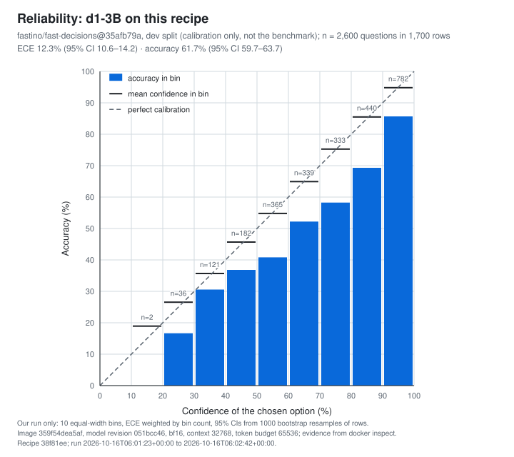

# d1-3B on TensorFold

[](LICENSE)
[](#requirements-and-limits)
[](#requirements-and-limits)
[](https://huggingface.co/LiquidAI/d1-3B)
[](#requirements-and-limits)
[](#requirements-and-limits)

**Serve Liquid AI's d1-3B decision model on one DGX Spark, measured up to 4.3× faster than stock llama.cpp.**

d1-3B reads a state (text, pictures, or both) and answers questions about it with probabilities, not
generated text. This recipe serves it with TensorFold's Python engine at a pinned commit plus three patches,
implementing llama-server's System One API. Everything runs on your machine; the weights are downloaded at a
pinned revision and checked before use.

| I want to... | Use | What you get |
|---|---|---|
| Serve d1-3B | [Quickstart](#quickstart)<br>`./start.sh`  | `POST /v1/systemone` and `/v1/decisions` on `127.0.0.1:8080` |
| Measure my server | [Reproduce](#reproduce-the-numbers)<br>`scripts/bench.sh run` | Latency, throughput and parity with the model's own code, under `results/` |
| Compare with stock llama.cpp | [Reproduce](#reproduce-the-numbers)<br>`scripts/llamacpp.sh start` | llama-server on Liquid AI's GGUF files, on `127.0.0.1:8081` |

## Stock llama.cpp vs TensorFold

The same GB10, BF16 weights on both, warm requests over loopback HTTP at 4096 context. Mean latency per
request. llama.cpp ran before and after TensorFold, so each speedup covers both of its runs.

| Workload | llama.cpp | TensorFold | Speedup | Verdict |
|---|---:|---:|---:|---|
| One question | 27.90 / 28.19 ms | 24.09 ms | 1.16–1.17× |  |
| Three questions on one state | 118.61 / 119.36 ms | 27.36 ms | **4.34–4.36×** |  |
| One question, 3446-token prompt | 443.93 / 445.06 ms | 277.26 ms | **1.60–1.61×** |  |
| One question about a 384×288 picture | 101.04 / 100.22 ms | 47.02 ms | **2.13–2.15×** |  |
| 64 clients at once | 37.15 / 37.26 req/s | 40.70 req/s | 1.09–1.10× |  |

The overall verdict is **inconclusive**: the two llama.cpp runs of the one-question test spread too far apart to
call, and the burst's adverse bound (6.40%) went past its tolerance. Several questions on one state gain most:
when they fit in one forward pass, TensorFold reads the state once and branches each question off it.

Evidence: [summary](results/audited-bf16/summary.json) · [timings](results/audited-bf16/timings.json) ·
[memory](results/audited-bf16/memory-summary.json) · [provenance](results/audited-bf16/provenance.json)

<details>
<summary>What these numbers don't show</summary>

- **No decode speed:** every answer has zero output tokens. Prefill and time to first token were not recorded.
- **Warm only:** the first one-question request took 3.122 s; graph promotion took 94.19 ms and, for the long prompt, 886.02 ms.
- **Memory for TensorFold only:** +8.94 GiB loaded, +16.69 GiB after all workloads; shared-memory snapshots, not peaks.
- **Input tokens differ:** the summary flags a change in reported input tokens: 116 for TensorFold, 154 for llama.cpp.
- **Before packaging:** the built image passed integration checks, not a new comparison. Neither measures accuracy.
- **Shared host:** another inference service stayed resident. Each run answered 2320 measured requests after 340 warmups.
- **Q8_0 and Q4_K_M** were measured only against the engine this build replaced ([history](results/report.md)).

</details>

## Calibration (our run)

d1-3B on this recipe was run against the Fast Decisions dev split, pinned to
[`fastino/fast-decisions@35afb79a`](https://huggingface.co/datasets/fastino/fast-decisions/tree/35afb79a0f611a1db44380e855ac2a821b0a4da1).
The run covers 2600 single-label questions in 1700 rows.

Each question is sent as a `choice` over the dataset's own labels, verbatim and in their original order, with the
instruction `Choose the {task} label.` Confidence is the probability of the chosen option.

| Accuracy | ECE, 10 equal-width bins |
|---:|---:|
| 61.7% (95% CI 59.7–63.7) | 12.3% (95% CI 10.6–14.2) |

**d1-3B is over-confident in every confidence band.** In all nine populated bands, accuracy is 5.1 to 18.9 points
below the mean confidence.



Evidence: [summary](results/calibration/summary.json) · [manifest](results/calibration/manifest.json) ·
[every answer](results/calibration/answers.jsonl) · [gap per band](results/calibration/accuracy-minus-confidence.svg)

Scripts: [`bench/calibration.py`](bench/calibration.py) and [`bench/calibration_chart.py`](bench/calibration_chart.py).
To reproduce, write to a fresh directory:

```bash
python3 bench/calibration.py fetch && ./start.sh
python3 bench/calibration.py run --out results/calibration-mine && ./stop.sh
python3 bench/calibration.py score --out results/calibration-mine
python3 bench/calibration_chart.py --summary results/calibration-mine/summary.json
```

<details>
<summary>What these numbers don't show</summary>

- **Not comparable** with vendor figures for other models, prompts, data or binning.
- **Dev split, calibration only:** the dataset card asks that scores on these files not be reported as its
  benchmark. The prompt mapping is ours, so 61.7% is not the model card's 69.3 on this split.
- **Single-label heads only:** the 300 multi-label heads were left out.
- **One run:**
  - one GB10, BF16 at 32768 context, recipe `38f81ee`, image `359f54dea5af`;
  - checkpoint checked against the pinned hashes;
  - intervals from 1000 bootstrap resamples of rows, seed 0.
- **Small bands:** the 10–20% band holds 2 questions and the 20–30% band 36.

</details>

## Quickstart

On a DGX Spark with Docker, the NVIDIA Container Toolkit and 56 GiB free ([requirements](#requirements-and-limits)):

```bash
git clone https://github.com/plotarmordev/d1-tensorfold.git
cd d1-tensorfold
./start.sh        # first run builds the image, downloads and verifies the weights, compiles kernels
curl -s http://127.0.0.1:8080/v1/systemone -H 'Content-Type: application/json' \
  -d '{"state":"I was charged twice this month, please refund one of them.",
       "questions":{"refund":{"type":"noul","instructions":"Is the customer asking for a refund?"}}}'
```

Answers are probabilities with zero output tokens ([example](results/example-response.json)); `./stop.sh` stops it. Settings such as
`CONTEXT`, `PORT` and `MIN_FREE_GIB` go in `scripts/local.sh` or the environment; see [the defaults](scripts/config.sh).

<details>
<summary>Question types, pictures and endpoints</summary>

| Type | Criteria | Answer |
|---|---|---|
| `noul` | Optional true/false descriptions | Probability of yes |
| `choice` | Option names mapped to descriptions | Chosen name, confidence, probabilities |
| `score` | 2 to 10 ordered descriptions | Expected level, confidence, probabilities, legend |

`questions` is an object keyed by ID. For pictures, send `images: ["data:image/jpeg;base64,..."]` with a text
`state` or `state: null`: up to four by default, no remote URLs or video. `/v1/decisions` has its own schema;
`/health` and `/v1/models` are available; chat and completions are refused. `TOKEN_BUDGET` is tokens per forward
pass, capped by `CONTEXT`; more questions are split across passes.

</details>

### Try it with your coding agent

Paste this into Claude Code, Codex, Cursor or whichever agent you use, on the DGX Spark:

```text
Help me serve Liquid AI's d1-3B with https://github.com/plotarmordev/d1-tensorfold
Read its README first and use only the repository's own scripts.

1. Check for an NVIDIA GB10, Docker with the NVIDIA Container Toolkit, and at least 56 GiB
   of available memory. Stop and tell me if anything is missing.
2. Clone the repository and run ./start.sh. The first run takes a while.
3. Send the README's example request and explain the answer.
4. If I ask for a benchmark: restart with CONTEXT=4096 ./start.sh, run
   ./scripts/bench.sh run http://127.0.0.1:8080 <a new label>, and summarize the result file.

Keep the server on 127.0.0.1. Don't reset the GPU, stop other services, or change settings I didn't ask for.
```

## Reproduce the numbers

```bash
python3 -m unittest discover -s tests -v                          # recipe checks, no GPU
CONTEXT=4096 ./start.sh && ./scripts/bench.sh run http://127.0.0.1:8080 my-tensorfold-bf16 && ./stop.sh
./scripts/llamacpp.sh start BF16                                   # or Q8_0, Q4_K_M
./scripts/bench.sh run http://127.0.0.1:8081 my-llamacpp-BF16 && ./scripts/llamacpp.sh stop
```

Each run writes `results/LABEL.json` and `results/parity-LABEL.json`, never overwriting. Parity compares with the
shipped [Transformers reference](results/reference.json); agreement is not accuracy. The table above came from a
separate, unreleased collector whose source revision was not recorded (hashes in [provenance](results/audited-bf16/provenance.json)).

The [live qualifier](bench/qualify_recipe.py) checks that repeated and concurrent answers agree with zero output
tokens. Stop the server, then run it in the built image with GPU access, the repository at `/recipe` (working
directory), the checkpoint at `/model`, and writable `/output` and `/cache`. The image's
[integration run](results/audited-bf16/integration.json) recorded 20 requests, no failures, five graph captures and 15 replays.

## Requirements and limits

- **Hardware:** one DGX Spark (GB10, arm64, compute capability 12.1). Other GPUs and multi-GPU are not qualified.
- **Software:** Linux, Docker with the NVIDIA Container Toolkit, a CUDA 13 compatible driver, Bash, curl, Git and
  Python 3. The first build needs Hugging Face (`HF_TOKEN` if required), NVIDIA NGC and GitHub.
- **Memory:** 56 GiB available at launch. Peaks at the full 32768 context are unknown, and one earlier launch
  could not create its CUDA context. Containers do not restart on their own.
- **BF16 only:** FP8 and INT4 are refused; their historical numbers need recipe commit `864a9fe`.
- **Not hermetic:** transitive build tooling is not locked; no registry image, no hosted CI.
- **Security:** `HOST=0.0.0.0` exposes an unauthenticated endpoint. Keep the loopback default or add access control.

## Credits

Built on [TensorFold](https://github.com/ashhart/TensorFold/tree/ed78d6fc204d89d90b045bf033d6551e7714f3a1) (Apache 2.0)
and, for the baseline, [llama.cpp](https://github.com/ggml-org/llama.cpp) (MIT). [d1-3B](https://huggingface.co/LiquidAI/d1-3B)
is by Liquid AI under the [LFM Open License v1.0](https://huggingface.co/LiquidAI/d1-3B/blob/051bcc464b01b9f92942b364d9586b0ef5912432/LICENSE);
the NGC container is under NVIDIA's terms; the bench picture is COCO val2017 image 39769. Weights and pictures are
downloaded, never redistributed. [Fast Decisions](https://huggingface.co/datasets/fastino/fast-decisions) is by
Fastino under Apache 2.0. Its texts are downloaded; the calibration answers repeat only its row ids, label names and
gold labels.

[Changelog](CHANGELOG.md) · [Evidence](results/audited-bf16) · [Pins](scripts/config.sh) · [Notice](NOTICE) · [Apache 2.0 license](LICENSE)
